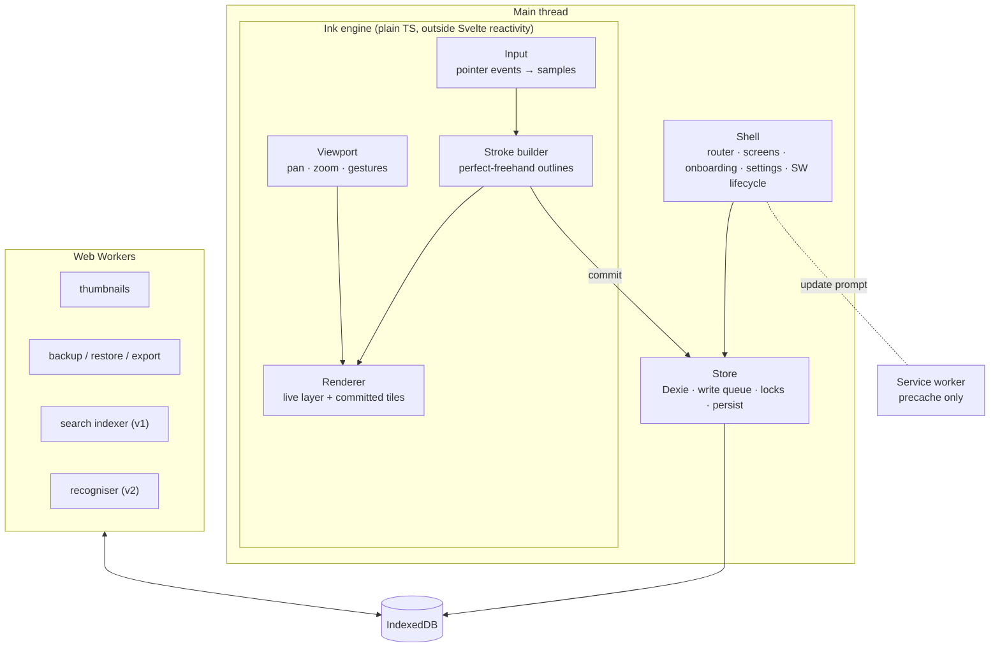
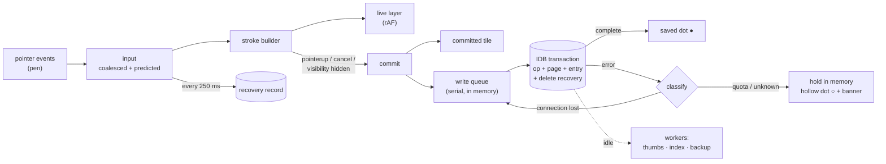

# Morning Pages — Technical Design Doc

| | |
| --- | --- |
| Status | Draft v1 — 2026-11-13 |
| Source | [Morning Pages — Journal Web App PRD](./Morning%20Pages%20—%20Journal%20Web%20App%20PRD.md) (Nov 13, 2026) |
| Companion docs | [Milestones.md](./Milestones.md) · [Decisions.md](./Decisions.md) |
| Target | Installable PWA on iPad + Apple Pencil (iPadOS 18 / 26), hosted as static files on Vercel |
| App name | **Morning Pages** (D-031) |
| Reference device | iPad Pro 12.9″ (6th gen, M2, 120 Hz ProMotion, 2732 × 2048 @ 2×) + Apple Pencil 2nd gen (A2051) (D-030) |

This document says **how** Morning Pages is built. The PRD says **what** and **why**; requirement IDs (PEN-3, DUR-1, BAK-4, …) refer to the PRD and are not restated here. Every non-obvious choice is logged in [Decisions.md](./Decisions.md) as `D-NNN`.

---

## 1. Goals and constraints that shape the design

1. **No stroke is ever lost.** The write path is designed first and everything else bends around it (§6).
2. **Static app, journal content never leaves the device.** No backend and no functions; Vercel serves files and headers only (§11). The one outbound channel is anonymous, allowlisted usage events to Umami, which the user can switch off (§9.4).
3. **Installed PWA is the real product.** Safari tabs are a trial mode; the Home Screen app has its own storage container (§10).
4. **Ink must feel like paper.** Pen-down to first pixel within one frame of app work; 120 Hz on ProMotion (§5).
5. **Small and fast.** App shell under 400 KB gzipped; cold launch to writable page under 1.5 s (PRD §12.1).
6. **Calm, crafted UI.** Designed through the Impeccable workflow against a written design context (§12).

Non-goals for the architecture: sync, accounts, server-side anything, native wrappers.

---

## 2. Tech stack

Library versions are **not** fixed in this doc. They are pinned in `package-lock.json` at M1 and upgraded deliberately.

| Layer | Choice | Notes | Decision |
| --- | --- | --- | --- |
| Language | TypeScript (strict) | `svelte-check` in CI | — |
| Build | Vite | Static `dist/` output, code-splitting per route | D-003 |
| UI | Svelte 5 (runes), plain Vite SPA, **no SvelteKit** | Tiny runtime; no inline bootstrap script, so strict CSP is easy | D-003 |
| Routing | ~40-line pathname router (`src/router.ts`) | ~10 routes, no library needed | D-004 |
| Ink | Canvas 2D + `perfect-freehand` | WebGL only if profiling demands it | D-008 |
| Storage | IndexedDB via Dexie | Append-only op log | D-005 |
| Offline | `vite-plugin-pwa` (Workbox `generateSW`), `registerType: 'prompt'` | User approves every update | D-009 |
| Zip | `fflate` in a Worker | Backup / restore | — |
| Search (v1) | MiniSearch in a Worker, index persisted in IndexedDB | — | — |
| PDF (v1) | `pdf-lib`, strokes as vector paths | Lazy-loaded chunk | — |
| Crypto (v1) | Web Crypto (AES-GCM, PBKDF2, HKDF); WebAuthn PRF (v2) | No third-party crypto | D-022 |
| Fonts | Fraunces (headings) + Atkinson Hyperlegible Next (UI), self-hosted via Fontsource npm packages | Bundled, precached | D-012 |
| Package manager | npm | Ships with Node; Vercel auto-detects lockfile | D-024 |
| Unit tests | Vitest + `fake-indexeddb` | Store, encoding, queue, backup | — |
| E2E tests | Playwright, **WebKit** project | Durability torture, network allowlist + content canary, CSP | — |
| Design | Impeccable skill + `npx impeccable detect` | §12 | D-013 |
| Usage analytics | Umami Cloud (free Hobby plan) via its HTTP API from our own ~60-line module, no third-party script | §9.4 | D-028, D-029 |
| Hosting | Vercel (static, Git integration) | §11 | D-001 |

---

## 3. Architecture overview



**Rule:** the writing path never awaits storage. Durability is reported back asynchronously (saved dot). Heavy work reads IndexedDB from workers.

### 3.1 Source layout

```
src/
  main.ts                 boot: open DB, read settings, mount App
  App.svelte              layout: sidebar / tab bar, route outlet, banners
  router.ts               pathname router + View Transitions
  ink/
    input.ts              pointer handling, coalesced/predicted, palm rejection
    gestures.ts           finger pan/pinch, 2-/3-finger tap undo/redo
    viewport.ts           page-space ↔ screen transform, inertia
    stroke.ts             tool presets → perfect-freehand options, Path2D
    simplify.ts           RDP decimation with pressure guard
    encode.ts             point codec (§7.3)
    renderer.ts           live layer, tile cache, paper backgrounds
    paper.ts              blank / lined / dotted / grid / Cornell patterns
    page.ts               fold ops → visible strokes; undo/redo stack
  store/
    db.ts                 Dexie schema + migrations
    queue.ts              serial write queue, durability callbacks
    entries.ts pages.ts ops.ts settings.ts   repositories
    recovery.ts           in-flight stroke mirror (DUR-4)
    locks.ts              Web Locks single-writer (DUR-7)
    persist.ts            persist(), estimate(), quota warnings
    crypto.ts             envelope encryption (v1)
  workers/
    rpc.ts                ~30-line postMessage request/response helper
    backup.worker.ts thumbs.worker.ts index.worker.ts
  screens/                Today, Library, Calendar, Timeline, Search, Entry,
                          Insights, Settings, Onboarding, Privacy, Diagnostics
  ui/                     shared components (Toolbar, Banner, SavedDot, …)
  styles/                 tokens.css, themes.css, fonts.css, base.css
  pwa/                    register.ts (update prompt), standalone.ts
  analytics/              track.ts (allowlisted events → Umami), events.ts (schema)
public/                   icons, apple-touch-icon, robots.txt
tests/e2e/                Playwright specs
PRODUCT.md DESIGN.md      Impeccable design context (repo root)
vercel.json               headers, rewrites
```

---

## 4. Routes and screens

| Path | Screen | Loaded | PRD |
| --- | --- | --- | --- |
| `/` | Redirect → `/today` (or `/onboarding` on first run, `/unlock` when locked) | main chunk | ENT-1 |
| `/today` | Writing canvas for today's entry in default journal | **main chunk** | §10.1 |
| `/entry/:id` | Same canvas, an existing entry; read-only if another tab holds the lock | main chunk | DUR-7 |
| `/library` | Home: journals, On This Day, streak, "Continue today", banners | lazy | §10.1 |
| `/calendar` | Month grid, Year in Pixels toggle (v1) | lazy | MEM-2, MEM-4 |
| `/timeline` | Infinite thumbnail list | lazy | MEM-3 |
| `/search` | Query + filters (v1) | lazy | SRC-* |
| `/insights` | Streak, stats, mood (v1/v2) | lazy | INS-* |
| `/settings` | Storage, backup, lock, defaults, themes, export, privacy | lazy | §10.1 |
| `/onboarding` | 3 screens + Add to Home Screen guide | lazy | STO-1 |
| `/privacy` | Plain-language privacy page | lazy | PRI-5 |
| `/deleted` | Recently Deleted | lazy | ENT-7 |
| `/diagnostics` | Debug HUD, local error log, self-check results | lazy | D-018 |

Only `/today` and `/entry/:id` are in the main chunk, so cold launch loads the canvas and nothing else. Navigation uses the View Transitions API when present and `prefers-reduced-motion` is not set.

Layout: collapsible sidebar on iPad landscape (≥ 900 px); bottom tab bar below that (iPhone, narrow Split View down to 320 px).

---

## 5. Ink engine

### 5.1 Coordinate systems

- **Page space** is the only space persisted. Every page has a fixed width of **1000 units**; height follows the page size chosen at creation (`A5` and `A4` share the √2 aspect, so both are 1414 units tall and the size only sets print scale; `fit` uses the viewport aspect at creation time). Height is stored on the page. Orientation changes, Split View resizes and zoom never touch stored coordinates.
- **Screen space** = page space × `viewport.scale` + `viewport.offset`, then × `devicePixelRatio` for canvas backing stores.
- Continuous scroll lays pages vertically with a fixed gap; the viewport maps a single scroll offset across them.

### 5.2 Input (PEN-1 … PEN-9)

```ts
canvas.addEventListener('pointerdown', onDown);   // pen → begin stroke; touch → gestures
canvas.addEventListener('pointermove', onMove);   // buttons===0 && pen → hover nib (PEN-8)
canvas.addEventListener('pointerup', onEnd);
canvas.addEventListener('pointercancel', onEnd);  // keep the stroke (§4.5 edge cases)
canvas.addEventListener('lostpointercapture', onEnd);
```

- **Palm rejection by input type:** only `pointerType === 'pen'` draws unless the "Draw with finger" setting is on (then `touch` with a single active pointer draws, and two fingers pan).
- **Samples:** on each `pointermove`, iterate `e.getCoalescedEvents?.()`; fall back to `[e]` when missing or empty. Guard against the Safari 18.2 coalesced `pointerId` bug by not filtering coalesced events on `pointerId` (risk table, §15).
- **Prediction:** `e.getPredictedEvents?.()` points are appended to the **live layer only** and dropped on the next event.
- **Per sample:** `x, y` (converted to page space), `pressure` (clamped 0–1; a `0` on pen-down becomes `0.5`), `altitudeAngle`/`azimuthAngle` (or derived from `tiltX`/`tiltY`), `timeStamp`.
- `setPointerCapture(e.pointerId)` on pen-down.
- **Suppress iOS behaviours on the canvas:** CSS `touch-action: none; user-select: none; -webkit-user-select: none; -webkit-touch-callout: none;` plus non-passive `touchstart`/`touchmove` listeners that `preventDefault()` to stop the selection loupe and double-tap zoom. Canvas is not editable, so Scribble does not engage. Verified in spike S1.
- `touch-action: none` disables native scrolling on the canvas, so **pan, pinch and inertia are implemented in `gestures.ts`** (D-007).

### 5.3 Gestures

| Gesture | Action |
| --- | --- |
| 1 finger drag | Scroll (with inertia) |
| 2 finger pinch / drag | Zoom (0.5×–4×) and pan |
| 2 finger tap (< 250 ms, < 10 px travel) | Undo |
| 3 finger tap | Redo |
| Pen hover, no buttons | Ghost nib preview |
| Long-press on toolbar tool | Radial preset menu |

### 5.4 Stroke building

- `stroke.ts` maps a tool preset to `perfect-freehand` options (fountain: high thinning, tapered start/end; ballpoint: thinning ≈ 0.1; pencil v1: tilt widens and lowers alpha; highlighter v1: multiply blend, drawn beneath ink).
- Live stroke: each animation frame recomputes the outline and fills a `Path2D` on the live layer. If profiling on long strokes shows frame cost growing, freeze the stroke prefix into the live bitmap every N points and only recompute the tail (note in code as `ponytail:` upgrade path).
- On commit, `simplify.ts` decimates points (RDP, ε ≈ 0.15 page units, keeping any point where pressure changes > 0.03) before encoding. Outline is rebuilt from the decimated points so what is stored is what is shown.

### 5.5 Rendering (INK-1 … INK-5)

- **Live layer:** one viewport-sized canvas on top, cleared and redrawn each `requestAnimationFrame` while a stroke is active, idle otherwise.
- **Committed layer** (D-040): every tile is a detached **1024 × 1024 px `<canvas>`** at a power-of-two resolution at or above the device scale, so it is only ever downsampled. It covers `1024 / res` page units: **512 units at the reference iPad's 2 px per unit**, fewer when zoomed in. Pages are at most 1000 CSS px wide on screen. New strokes draw incrementally into the tiles they intersect (via bbox), and each stroke's outline is built once and reused. Full tile redraws happen only on a resolution change, undo, erase or theme switch. Panning only re-blits tiles, at whole device pixels so no seams show.
- **Tile cache cap:** Safari enforces a global canvas memory limit and silently blanks canvases above it. The cache is an LRU capped by **pixels**: 24 tiles × 1024², about 100 MB, at every zoom. Evicted tiles release memory by setting `width = height = 0`.
- **Paper** (blank, lined narrow/college/wide, dotted, grid, Cornell) is drawn per tile beneath ink from `paper.ts`; optional grain texture rendered once into a pattern.
- **Dark paper / ink inversion:** ink colour is stored as a palette id (`ink.blueBlack`, …) plus hex for custom colours. Themes map palette ids to colours; custom colours are inverted by flipping OKLCH lightness. Pages stay readable in both modes.

### 5.6 Undo / redo and erasing

Undo never deletes data (DUR-2). Undoing a stroke writes an `erase` op; redo writes a `restore` op. The undo stack lives in memory per session (unlimited). The stroke eraser hit-tests against stroke outlines (bbox prefilter, then point-in-polygon on the outline) and writes one `erase` op per gesture with all hit targets. Partial (pixel) eraser is v1 and is modelled as `erase` of the original + new `stroke` ops for the surviving fragments.

### 5.7 Performance budgets and how they are measured

All budgets are measured on the reference device: iPad Pro 12.9″ (6th gen, M2) with Apple Pencil 2nd gen (D-030). At 120 Hz, "one frame of app work" means **8 ms**. This iPad supports Pencil hover, so PEN-8 is testable on it. Pencil double-tap exists on this Pencil but is not exposed to the web; squeeze and barrel roll are Pencil Pro features and are out of scope. The PRD's lower-end devices (iPad Air M1, 9th-gen iPad) are checked opportunistically if one is available, and the HUD numbers are recorded in the PR.

| Budget (PRD §12.1) | Instrument |
| --- | --- |
| Pen-down → first ink ≤ 1 frame of app work | `performance.now()` at pointerdown vs. end of first rAF draw, shown in `/diagnostics` HUD; high-speed video for end-to-end |
| < 1 % dropped frames | rAF delta histogram in HUD over a 5-min session |
| Persisted < 1 s p99 | queue timestamps (enqueue → `complete`), p50/p99 in HUD |
| Cold launch < 1.5 s | `performance.mark('writable')` vs. navigation start, logged locally |
| App shell < 400 KB gz | CI script sums the gzipped **launch-critical** bytes: `index.html`, the entry and `/today` chunks, their CSS, and any preloaded font files. Fails the build over budget. Total service-worker precache size (all routes, fonts, prompt packs) is reported separately in the PR, not gated (D-027) |

The owner develops on Windows, so Safari Web Inspector is not available. `/diagnostics` (also toggled by a 4-finger long-press on the canvas) is the primary on-device debugging tool (D-018).

### 5.8 Handwriting recognition model delivery (v2)

The owner accepted a 15–25 MB on-device model (D-034). Spike S4 picks the model; delivery is fixed here so it never hurts launch or offline use:

- **Opt-in, on demand.** Settings → "Search my handwriting" shows the download size and starts the download. It is never part of the service-worker precache, so app updates and first install stay small.
- **Same origin.** The model is served from `/models/<name>-<version>.<ext>` on our own Vercel deployment. No CDN, no third party. Check Vercel's per-file size limit at M13 and split the model into chunks if needed.
- **Own cache bucket.** Stored in a dedicated Cache Storage bucket (`models-v<version>`), with resumable chunked download and a SHA-256 check before first use. A new app release does not re-download unless the model version changes.
- **Runs in `recognize.worker.ts`** during idle time only (PRD §9.3). If the model ships as WebAssembly, `'wasm-unsafe-eval'` is added to `script-src` in the same commit.
- If the download fails or storage is short, handwriting search simply stays off; nothing else depends on it.

---

## 6. The save pipeline (durability)

This replaces the diagram embedded in PRD §11.



### 6.1 Write queue (`store/queue.ts`)

- One serial queue per tab. Each item is **one IndexedDB transaction** (DUR-1). Order is preserved; a later stroke never commits before an earlier one.
- The **first stroke of a new entry** commits the `entry`, `page` and `op` records in the same transaction (ENT-1: no empty entries, no orphan strokes).
- Every stroke transaction also updates `pages.opCount`, `pages.checksum` (running CRC32 of op ids) and `entries.updatedAt`, and deletes the recovery record.
- Dexie's `db.transaction()` promise resolves only after the IDB `complete` event. **The saved dot turns solid only on that resolution.**
- The DB is opened with `chromeTransactionDurability: 'strict'` (no-op where unsupported). With a 1 s budget, an fsync per stroke is affordable.

### 6.2 Error handling

| Error | Cause | Response |
| --- | --- | --- |
| `UnknownError` / `InvalidStateError` "connection … lost" | Known WebKit bug after backgrounding | Close and reopen Dexie, retry (backoff 50 / 200 / 1000 ms), keep item queued |
| `QuotaExceededError` | Storage full | Hold all pending items in memory, show non-dismissable banner with "Back up now" and storage usage, keep accepting ink in memory (STO-4) |
| Anything else after 3 retries | Unknown | Hold in memory, hollow dot, write error to the local log, offer **emergency export** of pending strokes as a JSON file via share sheet |

Nothing is dropped from the in-memory queue until its transaction completes.

### 6.3 Exit and crash safety

- `visibilitychange → hidden` and `pagehide`: end any active stroke as if `pointerup`, enqueue it, and kick the queue (DUR-3).
- **Recovery record (DUR-4, pulled into MVP, D-017):** the stroke's op id is assigned at pen-down. While the stroke is active, its raw points are mirrored to `recovery` (keyed by that op id) every 250 ms, as a coalescing, low-priority queue item that never blocks stroke commits. When the stroke is enqueued for commit, any still-queued recovery item for it is dropped.
- **Replay is idempotent:** on launch, each recovery record is committed only if `ops.get(opId)` is missing, then deleted. A stale recovery write that lands after its stroke committed therefore never produces a duplicate stroke.
- iOS may suspend the app before a transaction started in `pagehide` completes; the recovery record is the safety net for that window.

### 6.4 Multi-tab safety (DUR-7)

`navigator.locks.request('entry:' + id, { ifAvailable: true }, …)` is held for as long as an entry is open for writing. If the lock is unavailable the entry opens **read-only** with a banner. On iPad the Home Screen app is effectively single-instance, so this mostly protects desktop browsers.

### 6.5 Storage protection (STO-3, STO-4)

- On every launch until granted: `navigator.storage.persisted()` → if false, `navigator.storage.persist()`. Result is shown in Settings ("Storage: protected" / "Storage: best effort — back up regularly").
- `navigator.storage.estimate()` on launch and after backups; banner at 80 % of quota.
- `localStorage` holds only UI preferences that are safe to lose (last tool, sidebar collapsed). Everything else is in IndexedDB (DUR-8).

### 6.6 Self-check (DUR-5)

A Worker job (development builds: after every write burst; production: once per day on first idle after launch) recomputes `opCount` and `checksum` per page from the `ops` store and compares with the page record. Mismatches are written to the local log and shown in `/diagnostics` and as a quiet Settings warning.

---

## 7. Data model and storage

### 7.1 Dexie schema (version 1)

All stores from the PRD data model are declared in version 1, even those first used in v1/v2, so early milestones do not need migrations (D-016). Only structural fields are indexed; content fields (tags, mood, title, text) are never indexed, because they will be encrypted when the journal lock is on (D-022). Filtering by tag or mood happens in memory: two years of entries is ~1,000 small records.

```ts
db.version(1).stores({
  journals:  'id, sortOrder',
  entries:   'id, journalId, entryDate, [journalId+entryDate], updatedAt, deletedAt',
  pages:     'id, entryId, [entryId+index]',
  ops:       'id, pageId, [pageId+seq]',
  blocks:    'id, pageId',
  assets:    'id, &hash',
  revisions: 'id, entryId',
  recovery:  'id',
  kv:        'key',          // settings + meta: schemaVersion, lastBackupAt, installId, log ring buffer
});
```

`deletedAt` is only set on deleted entries, so IndexedDB's index holds exactly the Recently Deleted set (null/undefined keys are not indexed).

### 7.2 Records

```ts
type Id = string;                       // crypto.randomUUID()
type LocalDate = `${number}-${number}-${number}`;  // 'YYYY-MM-DD' in the user's local zone (D-019)

interface Journal { id: Id; name: string; color: string; cover?: Cover; paper: PaperStyle;
                    template?: Id; sortOrder: number; createdAt: number; updatedAt: number }

interface Entry   { id: Id; journalId: Id; entryDate: LocalDate; createdAt: number; updatedAt: number;
                    title?: string; tags?: string[]; people?: string[]; mood?: 1|2|3|4|5;
                    energy?: 'low'|'med'|'high'; sleep?: 1|2|3|4|5; word?: string;
                    place?: string; weather?: WeatherIcon; starred?: boolean;
                    template?: Id; deletedAt?: number; sealedUntil?: LocalDate; hidden?: boolean;
                    enc?: Sealed }                // v1: content fields moved into enc when locked

interface Page    { id: Id; entryId: Id; index: number; paper: PaperStyle; size: 'A5'|'A4'|'fit';
                    height: number; opCount: number; checksum: number; thumb?: Blob; updatedAt: number }

interface Op {     // append-only; never updated or deleted except by purge of a deleted entry
  id: Id; pageId: Id; seq: number; createdAt: number;
  kind: 'stroke' | 'erase' | 'restore' | 'transform' | 'style';
  tool?: ToolId; color?: InkColor; size?: number;           // kind = stroke
  pts?: Uint8Array; n?: number; bbox?: [number, number, number, number];
  targets?: Id[];                                          // erase / restore / transform / style
  matrix?: [number, number, number, number, number, number]; // transform (lasso, v1)
  enc?: Sealed;
}

interface Block   { id: Id; pageId: Id; type: 'text'|'image'|'sticker'|'prompt'|'checklist';
                    frame: { x: number; y: number; w: number; h: number; rot: number };
                    content: unknown; assetId?: Id; updatedAt: number; deletedAt?: number }
interface Asset   { id: Id; hash: string /* sha-256 hex */; mime: string; size: number; blob: Blob }
interface Revision{ id: Id; entryId: Id; createdAt: number; marks: Record<Id /*pageId*/, number /*seq*/> }
```

**Page state = fold of its ops ordered by (`seq`, `createdAt`, `id`).** `seq` is a per-page counter owned by the single writer (§6.4); the tie-breakers only matter after a merge restore (§8.3).

**Version history (ENT-8) is just high-water marks** (D-015): a revision records the max `seq` per page. Restoring a revision computes the visible set at those marks and appends `erase`/`restore` ops to reach it — no copies, still append-only, and the restore itself can be undone.

**Purge:** entries with `deletedAt` older than 30 days are hard-deleted (entry, pages, ops, blocks, unreferenced assets) in an idle task on launch. This is the only hard delete outside Panic wipe (SEC-8).

### 7.3 Point encoding (budget: < 150 KB per handwritten page)

`pts` is a compact binary per stroke (`encode.ts`):

```
header:  u8 flags (bit0 hasPressure, bit1 hasTilt) · f32 x0 · f32 y0 · f64 t0
per point i ≥ 1, each field a zigzag LEB128 varint of the delta from point i-1:
  dx, dy      position, quantised to 1/16 page unit
  dp          pressure quantised to 0..255                    (if hasPressure)
  dalt, daz   altitude 0..63, azimuth 0..255 (wraps mod 256)   (if hasTilt)
  dt          milliseconds (unsigned varint)
```

Most deltas fit in one byte, so a point costs ~4–6 bytes. Combined with RDP decimation (§5.4) this targets a dense page of handwriting at well under 150 KB. **Spike S2 measures this on real pages from the owner**; if over budget, raise ε or drop `dt` resolution before changing the format. The codec has a round-trip unit test (encode → decode within quantisation error) and is documented for the open JSON schema.

### 7.4 Migrations (DUR-6)

1. On boot, open the DB **without a version** (Dexie dynamic mode) to read the stored version.
2. If it is lower than the code's version, show the "Updating your journal" screen that offers a backup **using the dynamic-mode connection** (reads the old shape), then closes it.
3. Open with the real schema; Dexie runs `upgrade()` functions. Upgrades must be idempotent (check-before-write) and are tested in CI against fixture snapshots of every previous schema version (`tests/fixtures/db-v{n}.json`).

### 7.5 IDs and dates

- IDs: `crypto.randomUUID()`. Ordering never relies on ids; it uses `seq`, `index`, `entryDate`, `createdAt`.
- `entryDate` is a local calendar date string (D-019), so travelling or DST never moves an entry to another day. `createdAt` / `updatedAt` are epoch ms.

---

## 8. Backup, restore and export

### 8.1 `.morningpages` file (BAK-1)

A zip (built by `fflate` in `backup.worker.ts`):

```
manifest.json            { format: "morningpages-backup", formatVersion: 1, appVersion, schemaVersion,
                           createdAt, encrypted: false, counts: {journals, entries, pages, ops, blocks, assets},
                           dateRange: [first, last], files: [{ path, bytes, sha256 }] }
records/journals.ndjson
records/entries.ndjson
records/pages.ndjson     (thumbs omitted; regenerated after restore)
records/ops.ndjson       pts as base64 of the §7.3 codec
records/blocks.ndjson
records/revisions.ndjson
records/kv.ndjson        portable settings only (no device state like persisted, lastBackupAt)
assets/<sha256>.<ext>    stored, not recompressed
README.txt               pointer to the open schema doc
```

JSON records use the deflate level 6; assets use `ZipPassThrough` (already compressed). Checksums use `crypto.subtle.digest('SHA-256')`.

**Encrypted backups (BAK-3, v1):** the outer zip holds `manifest.json` (counts only, `encrypted: true`, KDF params, wrapped key) and `payload.bin` = AES-GCM ciphertext of the inner zip above, in 4 MB chunks each with its own IV.

### 8.2 Delivery on iPad

`navigator.share()` needs a **fresh user gesture**, and building a large backup takes longer than the activation window. So backup is two taps (D-020): **Back up now** → worker builds the file with a progress bar → **Save backup** button calls `navigator.share({ files: [file] })` (Save to Files, AirDrop, USB drive). If `navigator.canShare({ files })` is false, fall back to an `<a download>` link. `kv.lastBackupAt` is written only after `share()` resolves.

Ceiling: the backup Blob is assembled in memory from chunks. A 500 MB journal fits on M1-class iPads; older devices may struggle. Incremental backups (BAK-5, v2) are the upgrade path.

### 8.3 Restore (BAK-4)

1. Pick file (`<input type="file" accept=".morningpages,application/zip">`).
2. Worker reads the manifest, verifies every `sha256`, and returns a preview (counts, date range, size, encrypted?).
3. **Merge:** journals / entries / pages / blocks by id, newest `updatedAt` wins; ops are immutable, so union by id; assets by hash. After a merge, each touched page's `opCount` and `checksum` are recomputed from its ops, and the writer's `seq` counter restarts at max + 1. Because two diverged copies can both hold the same `seq`, the page fold always orders ops by (`seq`, `createdAt`, `id`). **Replace:** first auto-builds a backup of current data (offered for saving), then clears and imports.
4. Imports run in batched transactions of 500 records; the restore is resumable because every record write is idempotent.
5. After restore: rebuild thumbnails and (v1) search index in the background.

The trial-mode handoff (STO-2) is the same file: export in the Safari tab, import in the Home Screen app.

### 8.4 Backup reminders (BAK-2)

On `/library` only (never on the canvas): a quiet banner when `now - lastBackupAt > reminderDays` (default 7, range 1–30).

### 8.5 Export (v1/v2)

PDF via `pdf-lib` (vector outlines from the same `perfect-freehand` polygons), PNG via `OffscreenCanvas.convertToBlob`, SVG as `<path>` per stroke, Markdown (v2) from typed blocks + recognised text. All in `backup.worker.ts`, all lazy-loaded.

---

## 9. Security and privacy

### 9.1 Network policy (PRI-1 … PRI-4, amended by D-028)

- After first load, the app makes exactly two kinds of request:
  1. the service worker checking for a new `sw.js` (and, in v2, the opt-in model download from our own origin);
  2. anonymous usage events to `https://gateway.umami.is/api/send`, unless the user has switched them off (§9.4).
- No fonts, scripts, images or APIs come from other origins. There is no third-party script: events are sent with `fetch` from our own bundled module.
- **Journal content never leaves the device.** Enforced by CSP (§11.2), by the event allowlist (§9.4), and by an e2e "canary" test that writes a known string and asserts it never appears in any request (§13).
- Source code is public (PRI-6). Builds are deterministic (lockfile, `npm ci`, no build-time timestamps in bundles; version comes from the git SHA).

### 9.2 Journal lock and encryption at rest (v1, SEC-1 … SEC-5)

- **Data key (DK):** random 256-bit AES-GCM key, never stored unwrapped.
- **Passphrase KEK:** PBKDF2-SHA-256, 600,000 iterations, 16-byte random salt → AES-KW wraps DK. Stored in `kv.keyring`.
- **Recovery KEK:** 24-word code (bundled BIP-39 English wordlist, 256 bits of entropy) → HKDF → second wrap of DK.
- **Passkey KEK (v2, SEC-3):** WebAuthn PRF output → HKDF → third wrap. Passphrase always remains.
- **What is encrypted:** each record's content fields are serialised and sealed into `enc = { iv, ct }` (AES-GCM, 12-byte random IV, record id as additional data). Structural fields (ids, `journalId`, `entryDate`, `seq`, `pageId`, `updatedAt`, `deletedAt`) stay plaintext so indexes keep working (D-022). Asset blobs are encrypted whole. The search index is stored as one encrypted blob.
- **Turning the lock on** migrates records in the background in batches with a resumable cursor in `kv`; turning it off reverses it.
- **In memory only:** the unwrapped DK lives in a module variable; auto-lock (default 5 min hidden) and the toolbar lock button drop it and route to `/unlock`. Auto-lock never fires before the exit flush in §6.3 has run.
- Privacy curtain (SEC-6, v2): on `visibilitychange → hidden`, add a blur class to the canvas (best effort).

### 9.3 Threat model additions

| Threat | Mitigation in this design |
| --- | --- |
| Malicious deploy from a compromised Vercel/GitHub account | Updates require user approval (prompt-mode SW); release notes in the update banner; public source; versioned git tags. SRI on same-origin bundles adds little here, see D-011. |
| Vercel preview injecting scripts (toolbar/feedback) | Toolbar disabled for the project; CSP blocks third-party scripts anyway (§11.4). |
| XSS via typed text or imported backups | Svelte escapes by default; no `{@html}` anywhere (lint rule); backups are parsed as data and validated per record shape before writing. |
| Analytics leaking personal data | Typed allowlist of event names and property values; route templates instead of URLs; numbers bucketed; canary test in CI; user can switch it off (§9.4). |
| Analytics vendor outage or ad-blocker | Events are fire-and-forget; failures are swallowed and never touch the write path. |

### 9.4 Usage analytics (D-028, D-029)

The site is public, and the owner wants to know how it is used. This section adds anonymous usage events without breaking the promise that journal content stays on the device. **This amends PRD principle 3, PRI-3 and §14.1**, which allowed only a landing-page counter.

#### Tool choice

| Option | Free tier (checked 2026-11-13) | Custom events on free tier | Fit |
| --- | --- | --- | --- |
| **Umami Cloud — Hobby** ✅ | 100K events/month, 1 website, 6-month retention | Yes, with event properties | Cookieless, open source, plain HTTP API so no third-party script is needed. Can be self-hosted later for longer retention. |
| Vercel Web Analytics — Hobby | 50K events/month; collection pauses when the cap is hit | **No** (custom events are Pro/Enterprise only) | Page views only on the free plan; not enough for event tracking. |
| PostHog Cloud | 1M events/month | Yes | Full product-analytics suite; SDK is heavy and stores an ID on the device by default. More than this app needs. |
| Cloudflare Web Analytics | Free, unlimited page views | No | Page views only. |
| Plausible | No free cloud tier (self-host only) | Yes | Needs a server to run for free. |
| GoatCounter | Free for non-commercial use | Limited | Very minimal; events modelled as paths. |

**Choice: Umami Cloud Hobby.** It is free, has real custom events with properties, sets no cookies, and can be called with `fetch` from our own code, so CSP only needs one extra `connect-src` origin and `script-src` stays `'self'`. Budget estimate: ~10 events per active user per day ≈ 300 per user per month, so 100K/month covers roughly 300 daily users. If usage outgrows it, drop `screen_view` sampling first, then move to Pro or self-hosted Umami.

#### How events are sent (`src/analytics/track.ts`)

```ts
const ENDPOINT = 'https://gateway.umami.is/api/send';
const WEBSITE = import.meta.env.VITE_UMAMI_WEBSITE_ID;      // public id, set in Vercel env
const PROD_HOST = import.meta.env.VITE_PRODUCTION_HOST;     // only send from production

export function track<E extends EventName>(name: E, data?: EventProps[E]) {
  if (!enabled()) return;                                    // setting off, wrong host, or dev build
  queueMicrotask(() => {
    try {
      fetch(ENDPOINT, {
        method: 'POST', keepalive: true, credentials: 'omit',
        headers: { 'Content-Type': 'application/json' },
        body: JSON.stringify({ type: 'event', payload: {
          website: WEBSITE, hostname: location.hostname, url: currentRouteTemplate(),
          language: navigator.language, screen: `${screen.width}x${screen.height}`,
          name, data: sanitize(name, data) } }),
      }).catch(() => {});                                    // offline, blocked, outage: drop silently
    } catch {}
  });
}
```

- **Page views** call the same function without `name`. They send the **route template** (`/entry`, never `/entry/<id>`) and no query string. The referrer is sent only on the first page view of a session and only as an external domain.
- **Only from production.** Nothing is sent from `localhost`, Vercel previews or test runs, so the data is clean and previews do not use the quota.
- **Never on the write path.** `track()` is called after a save completes or when a session ends, never inside pointer handling or the write queue. It can never throw into the app.
- **Offline:** events are dropped, not queued. Usage counts are approximate by design.
- **Opt-out:** Settings → Privacy → "Share anonymous usage stats", **on by default**. The default is disclosed on onboarding screen 1 ("Your journal stays on this iPad") and on the privacy page. Setting it off stops all requests to Umami immediately. The setting lives in `kv`, so it is backed up.

#### Event allowlist (`src/analytics/events.ts`)

Event names and property values are TypeScript union types. Numbers are always bucketed. `sanitize()` drops anything not in the schema, and a unit test fails if a property could carry free text, an id or a date.

| Event | Properties | Fires when | Answers |
| --- | --- | --- | --- |
| *(page view)* | route template | route change | Which screens are used |
| `app_open` | `mode`: standalone \| browser · `morning`: bool | each launch | Daily use, installed vs tab |
| `install_detected` | — | first launch in standalone mode (once per install) | Installs |
| `onboarding_step` | `step`: 1 \| 2 \| 3 | each onboarding screen | Where visitors drop off |
| `onboarding_done` | — | onboarding finished | Activation |
| `entry_started` | `template`: built-in template id \| none · `input`: pen \| finger \| keyboard | first stroke or keystroke of a new entry | Writing activity, input mix |
| `session_end` | `minutes`: 0-5 \| 5-15 \| 15-30 \| 30+ · `pages`: 1 \| 2-3 \| 4+ · `tools`: list of tool ids used | app hidden after writing | Session length, tool use (one event, not one per tool) |
| `closeout_done` (v1) | — (never the mood value) | close-out card saved | Ritual adoption |
| `backup_done` | `size`: <10MB \| 10-100MB \| 100MB+ · `encrypted`: bool | share sheet completed | Backup habit |
| `restore_done` | `mode`: merge \| replace | restore finished | Device moves, recovery |
| `export_done` (v1) | `format`: pdf \| png \| svg \| md | export saved | Export use |
| `search_used` (v1) | `filters`: 0 \| 1 \| 2+ | search run | Search adoption |
| `lock_enabled` (v1) | — | journal lock turned on | Security adoption |
| `recognition_enabled` (v2) | `ok`: bool | model download finished or failed | Recognition adoption |
| `update_applied` | `version`: app version | SW update applied | Release uptake |
| `persist_status` | `granted`: bool | once per install, when known | How often iPadOS grants persistence |
| `storage_warning` | `pct`: 80 \| 95 | quota threshold crossed | Storage pressure |
| `save_error` | `kind`: connection \| quota \| unknown · `recovered`: bool | write-queue error classified (§6.2) | **Durability in the wild** — the most important event |
| `launch_perf` | `ms`: <1000 \| 1000-1500 \| 1500-3000 \| 3000+ | once per day | Launch budget in the field |

Never sent: entry or page ids, dates of entries, titles, tags, people, mood, energy, prompts, typed text, recognised text, stroke data, file names, journal names, exact counts or durations, or anything from `kv` other than the app version.

#### Dashboard

The Umami dashboard shows page views, visitors, countries and devices automatically. Pin these reports: installs per week (`install_detected`), onboarding funnel (`onboarding_step` → `onboarding_done` → `entry_started`), daily writers (`app_open` with `mode = standalone`), backup rate (`backup_done`), and `save_error` count, which should stay at zero.

---

## 10. Progressive Web App on iPad

### 10.1 Manifest (`vite-plugin-pwa` generates `manifest.webmanifest`)

```json
{
  "id": "/",
  "name": "Morning Pages",
  "short_name": "Morning Pages",
  "start_url": "/",
  "scope": "/",
  "display": "standalone",
  "orientation": "any",
  "background_color": "#F7F3EA",
  "theme_color": "#F7F3EA",
  "categories": ["lifestyle", "productivity"],
  "icons": [
    { "src": "/icons/icon-192.png", "sizes": "192x192", "type": "image/png" },
    { "src": "/icons/icon-512.png", "sizes": "512x512", "type": "image/png" },
    { "src": "/icons/icon-maskable-512.png", "sizes": "512x512", "type": "image/png", "purpose": "maskable" }
  ]
}
```

`id` and `start_url` are fixed forever; changing them makes iPadOS treat it as a different app. The name is final: **Morning Pages** (D-031). `short_name` avoids a bare "Pages", which would sit next to Apple's Pages app. If iPadOS truncates "Morning Pages" under the icon (checked in spike S3), the fallback label is "Morning".

### 10.2 `index.html` head (iOS specifics)

```html
<meta name="viewport" content="width=device-width, initial-scale=1, viewport-fit=cover">
<meta name="mobile-web-app-capable" content="yes">
<meta name="apple-mobile-web-app-capable" content="yes">
<meta name="apple-mobile-web-app-title" content="Morning Pages">
<meta name="apple-mobile-web-app-status-bar-style" content="black-translucent">
<meta name="theme-color" content="#F7F3EA" media="(prefers-color-scheme: light)">
<meta name="theme-color" content="#1B1C1E" media="(prefers-color-scheme: dark)">
<link rel="apple-touch-icon" href="/apple-touch-icon.png">   <!-- 180×180, iOS ignores manifest icons -->
<link rel="manifest" href="/manifest.webmanifest">
```

- No `user-scalable=no`: browser zoom must work for UI text (PRD §10.4). The canvas handles its own pinch.
- Layout respects `env(safe-area-inset-*)` because of `viewport-fit=cover` and the translucent status bar.
- Icons and Apple splash images are generated from one SVG with `@vite-pwa/assets-generator` (light and dark splash).

### 10.3 Standalone detection and trial mode (STO-1)

```ts
export const isInstalled = () =>
  matchMedia('(display-mode: standalone)').matches || (navigator as any).standalone === true;
```

- Not installed → first visit routes to onboarding with the Share → Add to Home Screen steps (illustrated, iPadOS 18 and 26 variants), and every screen shows a slim **"Trial mode — not saved long-term"** strip.
- Installed → normal app; `persist()` requested (§6.5).
- Onboarding and Settings state plainly: **deleting the Home Screen icon deletes the journal**, and Safari-tab pages do not appear in the installed app.

### 10.4 Service worker

- `vite-plugin-pwa`, `strategies: 'generateSW'`, `registerType: 'prompt'`, **`injectRegister: false`** — registration happens from our own bundled `pwa/register.ts` via `virtual:pwa-register`, so no inline script is injected (required by `script-src 'self'`; verify in M1 by inspecting `dist/index.html`).
- Precache: app shell, all route chunks, fonts, icons, paper textures, prompt packs. `navigateFallback: '/index.html'`. No runtime caching rules (there is nothing else to fetch).
- **Update flow:** `onNeedRefresh` shows "Update available — what's new" banner on `/library` and `/settings` only, never on the canvas. "Update" calls `updateSW(true)` only after the write queue is empty.
- `sw.js` is served with `Cache-Control: no-cache` (§11.2) so update checks are not stuck behind a CDN cache.

### 10.5 Reminders

No push (PRD §6.6). Settings offers a generated `.ics` file with a daily `RRULE` (v2) delivered through the same share sheet.

---

## 11. Deployment on Vercel

### 11.1 Project setup

| Setting | Value |
| --- | --- |
| Framework preset | Vite |
| Build command | `npm run build` (`vite build` + bundle-size check) |
| Output directory | `dist` |
| Install command | `npm ci` |
| Node version | Current LTS, pinned in `package.json` `engines` |
| Git integration | GitHub repo; `main` → Production, every PR → Preview |
| Functions / Edge / Middleware | **None** (PRI-1) |
| Vercel Web Analytics, Speed Insights | **Off.** Usage analytics use Umami instead (§9.4, D-028) |
| Environment variables | `VITE_UMAMI_WEBSITE_ID`, `VITE_PRODUCTION_HOST` (Production only; both are public values, not secrets) |
| Vercel Toolbar | **Disabled** for Preview and Production (Project Settings → Vercel Toolbar; or env `VERCEL_PREVIEW_FEEDBACK_ENABLED=0`, verify at M1) |
| Deployment Protection | **Off for previews** (D-026). Vercel Authentication would 401 the credential-less manifest fetch and the Home Screen container does not share Safari's login cookie, so installed previews would break. The app is static, open source and previews hold test data only. |

Deploys can be done with the Vercel Git integration or `vercel deploy` / `vercel deploy --prod` from the CLI.

### 11.2 `vercel.json`

```json
{
  "$schema": "https://openapi.vercel.sh/vercel.json",
  "rewrites": [{ "source": "/((?!assets/).*)", "destination": "/index.html" }],
  "headers": [
    {
      "source": "/(.*)",
      "headers": [
        { "key": "Content-Security-Policy", "value": "default-src 'self'; script-src 'self'; style-src 'self'; img-src 'self' blob: data:; font-src 'self'; connect-src 'self' https://gateway.umami.is; worker-src 'self' blob:; media-src 'self' blob:; manifest-src 'self'; object-src 'none'; base-uri 'none'; form-action 'none'; frame-ancestors 'none'; upgrade-insecure-requests" },
        { "key": "X-Content-Type-Options", "value": "nosniff" },
        { "key": "Referrer-Policy", "value": "no-referrer" },
        { "key": "Permissions-Policy", "value": "geolocation=(), camera=(self), microphone=(self), payment=(), usb=()" },
        { "key": "Cross-Origin-Opener-Policy", "value": "same-origin" },
        { "key": "Strict-Transport-Security", "value": "max-age=63072000; includeSubDomains; preload" }
      ]
    },
    { "source": "/assets/(.*)", "headers": [{ "key": "Cache-Control", "value": "public, max-age=31536000, immutable" }] },
    { "source": "/sw.js", "headers": [{ "key": "Cache-Control", "value": "no-cache" }] },
    { "source": "/manifest.webmanifest", "headers": [
      { "key": "Cache-Control", "value": "no-cache" },
      { "key": "Content-Type", "value": "application/manifest+json" } ] }
  ]
}
```

- Vercel serves real files before applying rewrites, so the rewrite only affects app routes. `/assets/` is excluded so that a missing hashed chunk (e.g. from an old deploy) returns 404 instead of `index.html` cached as `immutable` for a year.
- CSP is a **response header, not a `<meta>` tag**, because `frame-ancestors` is ignored in meta CSP.
- `style-src 'self'`: Svelte emits a CSS file and sets dynamic styles via CSSOM, which CSP allows. If any compiled `style="…"` attribute is blocked in Safari during M1, the fallback is adding `'unsafe-inline'` to `style-src` only (low risk), logged as a decision.
- `'wasm-unsafe-eval'` is added to `script-src` only if v2 handwriting recognition ships a WebAssembly model.
- `https://gateway.umami.is` in `connect-src` is the only third-party origin, and only for `fetch` (no scripts, no images). Events go straight to Umami rather than through a Vercel rewrite, because a proxy would replace each visitor's IP with Vercel's and Umami could no longer tell visitors apart.

### 11.3 The domain is part of the data (read this before going live)

IndexedDB is scoped to the **origin**. Consequences:

- **The production domain must be final before real daily journaling starts** (end of MVP). Moving to another domain later leaves every installed journal behind; the only path across is backup → install new → restore. (D-002)
- **Every Vercel preview URL is a separate origin with empty storage.** Previews are for testing builds, never for real journaling. Real data lives only on the production domain's installed app.
- `*.vercel.app` works, but a custom domain is recommended so the app is not tied to the Vercel project name. The name is settled (Morning Pages); the **domain** is still an open question for the owner (§16).
- The site is public (D-032). Anyone can open it; first-time visitors in Safari land on onboarding, which doubles as the landing page. Add `<title>`, `<meta name="description">` and Open Graph tags so shared links read well; all assets are same-origin.

### 11.4 Release flow

1. Branch per milestone, one commit per feature (see [Milestones.md](./Milestones.md)).
2. PR → CI green → Vercel Preview → test on iPad against the preview (installed to Home Screen as a test app with test data only).
3. Merge → Production deploy → installed apps see "Update available" and the owner applies it.
4. Tag releases `vX.Y.Z`; release notes feed the update banner.
5. Rollback = Vercel Instant Rollback. The service worker sees a changed `sw.js` and offers the rolled-back build as an update. Because schema migrations are forward-only, **a release that bumps the DB version cannot be rolled back past**; such releases ship alone and are dogfooded on a preview first.

---

## 12. Design system and the Impeccable workflow

Visual design is produced with **[Impeccable](https://impeccable.style)**, a design skill for AI coding agents with commands for planning, critiquing, auditing and polishing UI, plus a deterministic anti-pattern detector (D-013).

### 12.1 Setup (M1)

```bash
npx impeccable install -y --providers=claude --scope=project --no-hooks
```

Run from the repo root. It writes the skill into the project's `.claude/` folder, which is committed so every session and contributor gets the same version. The platform engine binary under `.claude/skills/impeccable/scripts/bin/` is gitignored; the launcher downloads it on first use and verifies it against `engine-checksums.txt`. Then in Claude Code:

```
/impeccable init
```

`init` interviews for product facts and writes **`PRODUCT.md`** (done in M1.7). **`DESIGN.md`** is written by the first visual-world pass, the M1.8 tokens. Seed it with:

- **Product:** private, pen-first morning journal; used half-awake at 6 a.m.; calm, not gamified; trust is the feature.
- **Palette (PRD §10.3):** paper cream `#F7F3EA`, ink blue-black `#1E2A3A`, accent terracotta `#C2653A`, muted sage (success), Night charcoal `#1B1C1E`. Expressed as OKLCH tokens with **tinted neutrals** (no pure black or grey).
- **Type:** Fraunces for headings and dates; Atkinson Hyperlegible Next for UI and typed text (D-012).
- **Motion:** ≤ 200 ms, View Transitions, honour Reduce Motion; no bounce or elastic easing.
- **Themes:** Paper, Linen, Night, Sepia, High Contrast.

`DESIGN.md` is the source of truth for tokens; `src/styles/tokens.css` implements it as CSS custom properties, and themes switch via `[data-theme]` on `<html>`.

### 12.2 Per-milestone loop

| When | Command | Purpose here |
| --- | --- | --- |
| Before building a screen | `/impeccable shape <screen>` | Plan layout and states before code |
| Building | `/impeccable craft` | Build with visual iteration (in-app browser preview) |
| First-run, empty states | `/impeccable onboard` | Onboarding, Add to Home Screen guide, empty Library/Timeline |
| Copy for warnings | `/impeccable clarify` | Backup, storage, "deleting the icon deletes the journal" |
| Error states | `/impeccable harden` | Quota full, IDB lost, restore failures, long text overflow |
| iPad / iPhone / Split View | `/impeccable adapt` | Sidebar ↔ tab bar, 320 px windows, portrait/landscape |
| Fonts and hierarchy | `/impeccable typeset` | Date headers, Dynamic Type |
| Motion | `/impeccable animate` | Page turn, save ink-blot, respecting Reduce Motion |
| Keep it calm | `/impeccable quieter`, `/impeccable distill` | Counterweight to feature growth |
| **Milestone exit** | `/impeccable critique` → `/impeccable audit` → `/impeccable polish` | Required before a UI milestone is closed |
| New components settle | `/impeccable extract` | Move repeated pieces into tokens/components |

Not used: `bolder`, `overdrive` (conflict with "calm, not gamified").

**Scope:** Impeccable governs the app chrome (screens, toolbar, banners, typography, colour). The ink canvas rendering is governed by §5 and real-device testing.

### 12.3 Detector in CI

```bash
npx impeccable detect --github src/
```

Runs in CI on every PR. Starts as a warning (annotated in the PR) during M1–M2 while the design system forms; becomes **blocking** from the MVP release onward.

### 12.4 Accessibility (PRD §10.4)

- Canvas element: `role="img"` with `aria-label` "Entry for Friday 13 November 2026, 2 pages" (updated live), and recognised text in an off-screen region when available.
- All controls are real `<button>`s with labels; touch targets ≥ 44 × 44 pt; mood uses shape + colour.
- Contrast ≥ 4.5:1 checked per theme by a unit test over the token table; `axe` runs in Playwright on non-canvas screens.
- `prefers-reduced-motion`, `prefers-reduced-transparency`, `prefers-contrast` media queries honoured.

---

## 13. Testing and CI

### 13.1 GitHub Actions (`.github/workflows/ci.yml`)

| Job | What | Blocks merge |
| --- | --- | --- |
| `check` | `npm ci`, `svelte-check`, `vitest run` | yes |
| `build` | `vite build`; bundle-size script (≤ 400 KB gz launch path); assert `dist/index.html` has no inline `<script>` | yes |
| `e2e` | Playwright **WebKit**: core flows, durability torture, network allowlist + content canary, axe | yes |
| `headers` | Parse `vercel.json`; assert CSP string matches the §11.2 policy exactly (PRI-2 plus the single Umami `connect-src`) | yes |
| `design` | `npx impeccable detect --github src/` (annotations; exit 2 = findings) | warning → blocking at MVP |

### 13.2 Key automated tests

- **Codec:** encode/decode round-trip; fuzzed point sequences; size regression on recorded fixture pages (< 150 KB).
- **Queue:** ordering; retry on simulated connection loss; hold on quota; saved callback only after commit.
- **Durability torture (Playwright WebKit):** synthetic pen strokes via dispatched `PointerEvent({ pointerType: 'pen' })`; reload mid-stroke; close the page mid-transaction; dispatch `pointercancel`; `visibilitychange`; fill quota with a stub; assert zero lost strokes after reopen (recovery included).
- **Backup round-trip:** fixture journal → backup → wipe → restore → deep-equal records and checksums; merge with conflicting `updatedAt`.
- **Migrations:** each `tests/fixtures/db-v{n}.json` upgraded to latest; idempotent re-run.
- **Network allowlist + content canary:** the test build sets `VITE_PRODUCTION_HOST` to the test host so analytics fire. Record `page.on('request')` after the `writable` mark. Every request must be either a same-origin `GET` (SW/assets) or a `POST` to `gateway.umami.is/api/send` whose body validates against the event allowlist (§9.4). The test writes typed text containing a unique canary string and a known entry id, and fails if either appears in any request. A second run with analytics switched off asserts zero requests to Umami.
- **Analytics schema:** unit test that every event's properties are enums, booleans or buckets; `sanitize()` drops unknown keys.
- **Crypto (v1):** known-vector tests for wrap/unwrap, PBKDF2 params, recovery-code derivation.

Playwright WebKit is not iPad Safari. **Real-device testing is a release gate**: the PRD §12.3 manual matrix and the weekly writing checklist.

### 13.3 Testing on the iPad during development

Service workers need a secure context, and the iPad reaching a dev machine by LAN IP is not one. Use either:

- `vite --host` with `@vitejs/plugin-basic-ssl` (accept the cert on the iPad), or
- the PR's Vercel Preview URL (HTTPS, real headers). Remember: separate origin, test data only.

`/diagnostics` shows pointer sample rate, coalesced/predicted availability, frame-time histogram, queue latency p50/p99, persist status, storage estimate and the local error log.

---

## 14. Observability

Two layers, and neither carries journal content:

- **Fleet view (anonymous):** the Umami events in §9.4. `save_error`, `persist_status`, `storage_warning` and `launch_perf` show whether durability and speed hold up on other people's iPads.
- **Device view (local only):** there is no remote error logging. `kv.log` is a ring buffer (last 500 events) of errors, queue retries, self-check results and launch timings. It is visible in `/diagnostics`, included in backups, and exportable as a text file for bug reports. Nothing is sent anywhere.

---

## 15. Technical risks

| Risk | Detection | Mitigation |
| --- | --- | --- |
| Safari canvas memory cap blanks tiles | Blank tile reports in HUD; S1 spike | LRU cap (§5.5), release memory on evict |
| WebKit IDB "connection lost" after backgrounding | Queue retry counter in log | Reopen + retry; hold in memory (§6.2) |
| Coalesced-events `pointerId` bug (Safari 18.2) | Feature check in S1 | Do not filter coalesced events by id |
| Long live strokes drop frames | HUD frame histogram | Freeze prefix, recompute tail (§5.4) |
| Point storage over budget | Codec fixture size test | Tune ε / `dt` quantisation (§7.3) |
| Share sheet rejects large files or loses activation | Manual test at 500 MB | Two-step backup (§8.2), download fallback |
| `injectRegister` or Svelte emits inline script/style | CI inline-script check; CSP violation in e2e | Bundled registration; `style-src` fallback (§11.2) |
| Domain change orphans journals | — | Decide domain before dogfooding (§11.3) |

---

## 16. Open questions and future direction

### 16.1 Answered by the owner (2026-11-13)

- [x] **Name:** Morning Pages (D-031).
- [x] **Reference device:** iPad Pro 12.9″ 6th gen + Apple Pencil 2nd gen, A2051 (D-030).
- [x] **Public vs personal:** public, with anonymous usage analytics (D-028, D-032).
- [x] **Cross-device:** not needed now; accounts and cloud storage may come later (D-033, §16.3).
- [x] **Recognition model size:** 15–25 MB accepted for now, delivered on demand (D-034, §5.8). Spike S4 still picks the model.

### 16.2 Still open

- [ ] **Production domain**: must be settled before the MVP dogfood starts (M6.5, §11.3). Moving domains later strands installed journals. Until then production is `morning-pages-rose.vercel.app`, holding test data only (D-039).

### 16.3 Future: accounts and cloud storage (not planned)

If accounts and cloud storage are added later, they replace PRI-1 (no backend) and need their own design doc. The current design already keeps that door open:

- Ids are UUIDs created on the device, so records from several devices never collide.
- Ink is an append-only op log with `updatedAt` and `deletedAt` tombstones. Syncing is the same merge as backup restore (§8.3): union of ops, newest record wins.
- Encryption is per record (§9.2), so a server could store sealed records and never read them (end-to-end encrypted sync).

Until then, WebDAV / own-storage backup (BAK-6) is dropped from the plan, and backup files are the only way to move a journal.

---

## 17. Requirement traceability (summary)

| PRD area | TDD section | Milestone |
| --- | --- | --- |
| PEN-1…9, INK-1…5, tools | §5 | M0 (S1), M2, M10 |
| DUR-1…8, STO-3/4 | §6 | M0 (S2/S3), M3, M11 |
| Data model §5.1, ENT-* | §7 | M3, M4, M7, M9, M10 |
| BAK-*, export §7.4 | §8 | M5, M11, M12, M13, M16 |
| PRI-*, SEC-* | §9, §11.2 | M1, M4, M6, M12, M16 |
| STO-1/2, PWA | §10 | M1, M4, M11 |
| §10 UX, accessibility | §4, §12 | every 🎨 milestone |
| §12 NFRs and tests | §5.7, §13 | M0, M1, M3, M6 |
| Usage analytics (owner request, amends PRI-3) | §9.4, §11.2 | M1, M3, M4, M5, later milestones per event |
| §9.3 handwriting recognition | §5.8 | M0 (S4), M13 |
